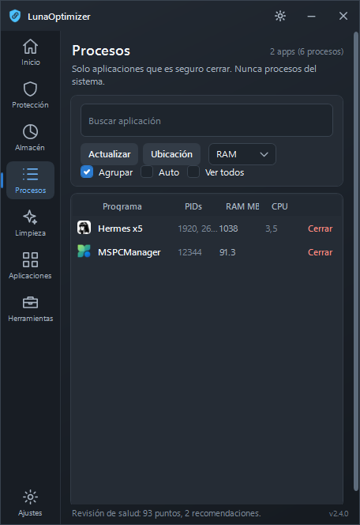
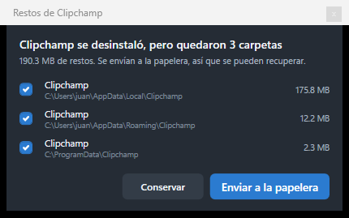
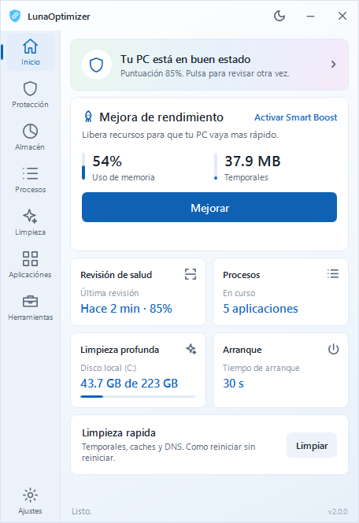
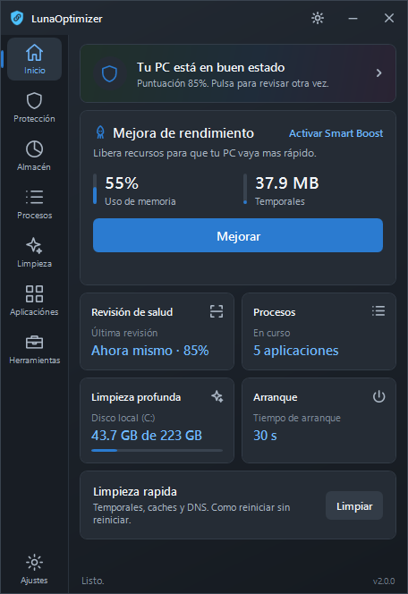
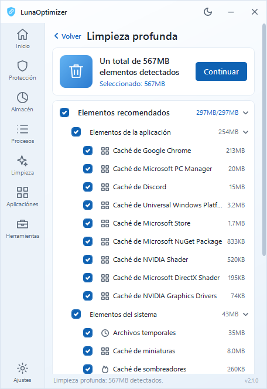
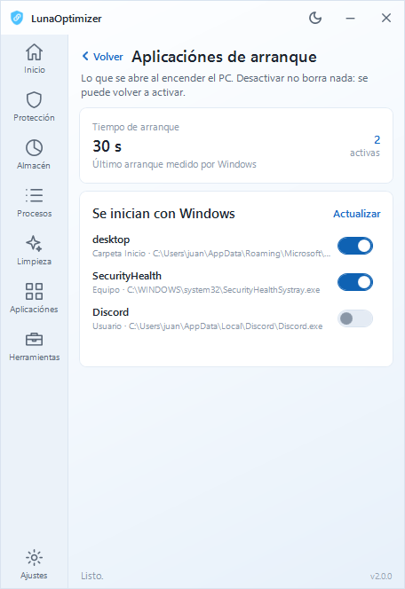
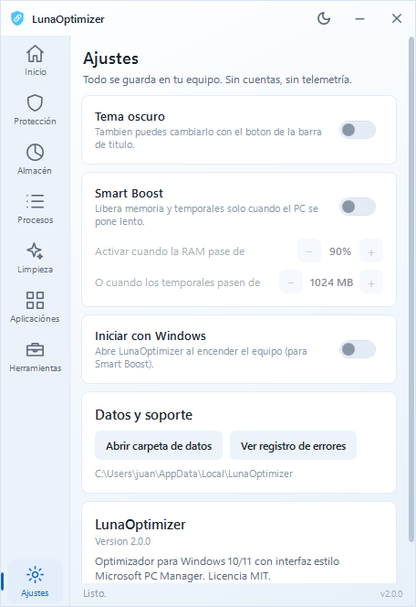

# LunaOptimizer ⚡

Optimizador de PC para **Windows 10/11** con una interfaz calcada a _Microsoft PC Manager_:
ventana compacta de 456×664, rail lateral con iconos, tarjetas blancas y un único botón
grande para mejorar el rendimiento.

- **Sin instalación**: un `.exe` único y autocontenido (no hace falta tener .NET instalado).
- **Todo en español**, sin telemetría, sin anuncios, sin cuentas.
- Tema **claro u oscuro**; en el primer arranque sigue la preferencia de Windows.
- Motor de limpieza basado en [FluentCleaner](https://github.com/builtbybel/FluentCleaner) (MIT)
  y la base de reglas **Winapp2.ini**.

---

## Novedades de la versión 2.0

| Antes (1.x) | Ahora (2.0) |
| --- | --- |
| Tema oscuro por defecto, rail de 6 pestañas | Paleta y estructura de PC Manager: rail de 8 secciones, tarjetas con borde de 1 px, azul de acento `#0F62B3`, tema claro/oscuro que sigue a Windows |
| Solo Inicio / Procesos / Limpieza / Juegos / Salud / Apps | Se añaden **Protección**, **Almacenamiento**, **Arranque**, **Herramientas** y **Ajustes** |
| — | **Revisión de salud** con puntuación, lista de problemas y acción por línea |
| — | **Antivirus**: estado de Windows Defender, firmas y **examen rápido** real |
| — | **Arranque**: apps que se inician con Windows, activar/desactivar y tiempo de arranque |
| — | **Almacenamiento**: uso por unidad, tamaño de cada carpeta y archivos grandes a la papelera |
| — | **Smart Boost**: optimiza solo cuando la RAM o los temporales pasan del umbral |
| — | **Inicio con Windows** desde Ajustes, con umbrales configurables |

### Pulido de la interfaz y del rendimiento (2.4)

- **Columna CPU** en Procesos, muestreada entre refrescos (sin dormir el hilo): el primer
  refresco la deja vacía y a los 1,5 s aparece sola. PC Manager no la muestra, así que esto
  es "un poco mejor".
- **Iconos en la lista de Aplicaciones**: se sacan del `DisplayIcon` del registro o del
  primer `.exe` de la carpeta de instalación, en paralelo y con tope de tiempo. Las que no
  tienen icono igual quedan alineadas.
- **Ordenar** por RAM, CPU o nombre, y en Aplicaciones por nombre o tamaño.
- **Aplicaciones de la Store con etiqueta `Store`**, y subtítulo que arma
  `editor · versión · tamaño` salteando los datos que faltan (antes quedaba un `·` suelto).
- **ComboBox con los colores del tema**: en oscuro salía blanco porque no había plantilla.
- **Números y fechas en español**: la app fija `es-AR` al arrancar. Antes, en un Windows en
  otro idioma, se mezclaban `59.66 GB` con `0,5 GB` en la misma pantalla.
- Acentos corregidos: **Aplicaciones**, **Ubicación**, **Limpieza rápida**, **más rápido**.

[](docs/procesos-2.4.png)

### Lo que se copió de PC Manager (2.3)

Después de inspeccionar los binarios de Microsoft PC Manager 3.23 (`Microsoft.WIC.PCManager.*`),
estas son las mecánicas que usa y que ahora tiene LunaOptimizer:

- **Cerrar apps con Job Objects.** PC Manager no mata procesos de uno en uno: crea un
  `Job Object`, le asigna el árbol completo y lo termina (`CreateJobObject` +
  `AssignProcessToJobObject` + `TerminateJobObject`). Así no quedan procesos huérfanos ni
  ventanas fantasma cuando una app lanza hijos (Chrome, Brave, Discord…). LunaOptimizer hace
  exactamente eso, y **antes** pide un cierre ordenado (`WM_CLOSE`) y espera 2,5 s para que
  la app guarde su estado; si no responde, fuerza. Un proceso del sistema (o `explorer`) se
  rechaza **entero**, con sus hijos: nunca se cierra nada del shell.
- **Apps de la Microsoft Store.** Se listan los paquetes MSIX con `Get-AppxPackage`
  (eliendo frameworks, recursos, paquetes NonRemovable y componentes de Windows) y se
  desinstalan con `Remove-AppxPackage`, que es lo único que funciona: su entrada del registro
  no tiene `UninstallString`. Aparecen mezcladas con los programas de escritorio.
- **Restos de una desinstalación.** Como PC Manager, después de desinstalar se buscan
  carpetas huérfanas: la carpeta de instalación si el desinstalador la dejó, y carpetas cuyo
  nombre empieza con el del programa o el del editor en `LocalAppData`, `Roaming`,
  `ProgramData`, `Program Files` y `LocalAppData\Packages`. Se muestran con su tamaño y se
  pueden destildar; lo que se borra **va a la papelera**. Nunca se propone `C:\Windows`,
  `C:\Program Files` ni carpetas del sistema, y las palabras genéricas (`windows`,
  `microsoft`, `store`…) no se usan para buscar.
- **Apps pesadas en el boost.** PC Manager trae una lista curada (Discord, Razer, Grammarly…)
  y ofrece cerrarlas al optimizar. El Inicio muestra `Discord en segundo plano · 1.1 GB` con
  un interruptor **Cerrarla al optimizar**, apagado por defecto; si se activa, se cierran con
  el mismo mecanismo ordenado + Job Object antes de liberar RAM.

[](docs/restos.png)

Lo mismo que PC Manager ya hacía y se mantiene: Boost por etapas (working set → lista
modificada → standby) vía `NtSetSystemInformation`, lista de procesos solo con apps que
tienen ventana visible y lista protegida, y el árbol de limpieza con casillas.

### Pantalla de limpieza estilo PC Manager (2.2)

- **Cabecera**: `Un total de X elementos detectados` + `Seleccionado: Y` + botón **Continuar**.
- **Árbol de casillas** igual que PC Manager: categoría → subcategoría → elemento.
  `Elementos recomendados` contiene **Elementos de la aplicación** (una fila por app con su
  caché: Chrome, Discord, Steam…) y **Elementos del sistema** (archivos temporales, caché de
  miniaturas, caché de sombreadores). Debajo: `Otros elementos del sistema` (Windows Update,
  optimización de entrega, informes de errores), `Seguimientos de uso del equipo` y `Papelera
  de reciclaje`.
- Cada fila tiene su casilla y su tamaño; las categorías muestran **seleccionado/total**
  (`297MB/297MB`) y las casillas de arriba marcan o desmarcan todo su contenido.
- Solo se listan elementos **con contenido real**, y las reglas de componentes de Windows
  (Update, logs, instalador, papelera, prefetch) ya no se ofrecen como "aplicaciones": las
  cubren los elementos del sistema.
- La caché de sombreadores aparece **desmarcada con aviso** si hay vídeo o juego en curso.

### Vista previa y navegadores (2.1)

- **Antes de borrar, se ve qué se va a borrar**: cada categoría se despliega con la
  lista de archivos (nombre, carpeta y tamaño) o de aplicaciones con su caché, y se
  puede **destildar** una categoría o una app concreta para conservarla.
- **Datos de navegadores protegidos**: de Chrome, Edge, Firefox, Brave, Opera y Vivaldi
  solo se limpia la **caché**. Historial, contraseñas, cookies, sesiones, marcadores,
  `Local Storage`, `IndexedDB` y preferencias **no se tocan**, y tampoco se borran sus
  claves de registro. El filtro se aplica al analizar (no aparecen en la lista) y otra
  vez al borrar.

### Rendimiento de la limpieza (2.0.1)

Un TEMP de 30.000 archivos pasó de **~43 s a ~4 s**. Lo que se cambió:

- **Una lectura de metadatos por archivo** (`GetFileAttributesExW`) en lugar de
  `Exists + Attributes + LastWriteTime + Length`, y borrado con `DeleteFileW`.
- **Borrado en paralelo** (4-8 hilos) por lotes, manteniendo la enumeración en un solo hilo.
- **Sin comprobación de existencia** después de borrar en los archivos pequeños
  (solo en los de más de 1 MB, donde la precisión importa).
- La pasada de **carpetas vacías** ya no recorre el árbol entero: solo sube desde las
  carpetas que perdieron archivos. Era el 80 % del tiempo.
- La tarjeta de Inicio **cachea la medida de temporales** 20 s en vez de recorrer el TEMP
  cada vez que entras o cada minuto con Smart Boost.
- La barra de progreso ahora **avanza con los bytes liberados**, no en modo indeterminado.

---

## Descargar

1. Entra en **[Releases](../../releases/latest)** y descarga el `.exe`
   (**`LunaOptimizer-V2.4.1.exe`**).
2. Doble clic → acepta el **UAC** (Windows pide permiso de administrador).
3. Listo: no hay instalador, puedes dejarlo en el Escritorio o en una memoria USB.

**Requisitos:** Windows 10 o 11 (x64). Nada más.

> ⚠️ **El programa pide administrador siempre.** Es necesario para cerrar procesos de otros
> programas, vaciar la caché del sistema, limpiar `%WINDIR%\Temp` y escribir ajustes de
> arranque del equipo. Si dices "No" en el aviso de Windows, la aplicación no arranca.

---

## Cómo se usa

### 🏠 Inicio



| Zona | Qué hace |
| --- | --- |
| **Banner superior** | Resume la última revisión de salud (puntuación y hace cuánto) y abre Protección. |
| **Mejora de rendimiento** | Libera RAM en varias etapas (working set → lista modificada → standby → libre) y borra temporales de todos los usuarios. Muestra el uso de memoria y los temporales antes de pulsar **Mejorar**. |
| **Smart Boost** | Enlace de la tarjeta: activa o desactiva la optimización automática (se configura en Ajustes). |
| **Cuatro tarjetas** | Revisión de salud, Procesos en curso, Limpieza profunda (uso del disco) y Arranque (tiempo real de arranque de Windows). |
| **Limpieza rápida** | Como un reinicio sin reiniciar (pide confirmación): cierra tus aplicaciones abiertas, borra temporales y DNS y libera RAM. |

**Tema oscuro** (desde Ajustes o el botón de la barra de título):



### 🛡️ Protección


**Revisión de salud** en una pasada:

| Comprobación | Qué mira |
| --- | --- |
| Archivos temporales | Tamaño de `%TEMP%` de todos los usuarios |
| Memoria RAM | Porcentaje en uso frente al total |
| Espacio en disco | GB libres y porcentaje del disco del sistema |
| Aplicaciones de arranque | Cuántas se inician con Windows |
| Protección antivirus | Tiempo real y antigüedad de las firmas de Defender |
| Limpieza del sistema | Última limpieza profunda |
| Reinicio pendiente | Actualizaciones de Windows esperando reinicio |

Devuelve una **puntuación de 0 a 100**, una lista con el estado de cada punto y un enlace
para arreglarlo (**Limpiar**, **Revisar**, etc.). La puntuación se guarda y se ve en Inicio.

**Antivirus de Windows**: estado de la protección en tiempo real, última fecha de firmas,
último examen y **Examen rápido** (lanza `MpCmdRun.exe -Scan -ScanType 1`, se puede cancelar).
Si el equipo usa otro antivirus, se avisa y no se toca nada.

### 💾 Almacenamiento


- **Unidades**: espacio usado y libre con barra, para discos fijos y extraíbles.
- **Carpetas**: mide Descargas, Documentos, Imágenes, Vídeos, Música, Escritorio y Temporales.
- **Archivos grandes**: busca archivos de más de 250 MB y los envía a la **papelera**
  (siempre recuperables; nunca borrado definitivo).
- Acceso directo a **Limpieza profunda**.

### 📋 Procesos

Lista **solo las aplicaciones que es seguro cerrar**: las que tienen una ventana visible,
sin procesos del sistema — el mismo criterio que usa PC Manager.

| Control | Qué hace |
| --- | --- |
| **Buscar** | Filtra por nombre con debounce de 300 ms. |
| **Cerrar** | Cierra ese programa entero (todos sus procesos). Sin confirmación: el resultado va a la barra de estado. |
| **Ubicación** | Abre la carpeta del `.exe` del proceso seleccionado. |
| **Agrupar** | Una fila por programa con todos sus PIDs y su RAM total (activado por defecto). |
| **Auto** | Refresca cada 2 segundos. |
| **Ver todos** | Incluye procesos del sistema y de fondo (aparecen como no cerrables). |

Nunca se pueden cerrar los procesos protegidos (`csrss`, `lsass`, `dwm`, `svchost`,
`explorer`, _Memory Compression_…).

### 🧹 Limpieza

Lista las **aplicaciones instaladas** con el espacio que ocupan sus datos de caché
(reglas de **Winapp2.ini** embebidas: Chrome, Steam, Epic, Spotify, juegos, etc.).

**Limpieza profunda** abre el análisis estilo PC Manager:



1. **Examinando** → barra de progreso, el elemento actual y los cinco grupos pasando de
   _Esperando a examinar…_ a _Descubierto X_.
2. Al terminar, la cabecera resume `Un total de 567MB elementos detectados` y
   `Seleccionado: 567MB`, y debajo aparece el **árbol de casillas** con lo que se va a
   borrar: `Elementos recomendados` → `Elementos de la aplicación` (una fila por app:
   `Caché de Google Chrome 213MB`, `Caché de Discord 15MB`…) y `Elementos del sistema`
   (`Archivos temporales 35MB`, `Caché de miniaturas 8.0MB`, `Caché de sombreadores`),
   más `Otros elementos del sistema`, `Seguimientos de uso del equipo` y `Papelera de
   reciclaje`. Cada categoría muestra **seleccionado/total**.
3. **Destilda** una categoría, una subcategoría o un elemento suelto: `Seleccionado` y el
   botón se recalculan y lo desmarcado no se toca.
4. **Continuar** → pide confirmación → borra y muestra lo liberado.
5. **← Volver** regresa a la pestaña anterior.

> **Navegadores:** historial, contraseñas, cookies, sesiones y marcadores quedan intactos;
> de Chrome, Edge, Firefox, Brave, Opera y Vivaldi solo se borra la caché. Esos archivos
> no aparecen ni en la lista.

**Grupos analizados:** elementos recomendados (`%TEMP%`, `C:\Windows\Temp` y el Temp de cada
usuario), otros del sistema (Windows Update, INetCache, Delivery Optimization, informes WER),
cachés de aplicaciones (Winapp2.ini), seguimientos de uso y papelera de reciclaje.

### ⚡ Arranque



- Lee las claves `Run` del usuario y del equipo (32 y 64 bits), las carpetas **Inicio** y el
  registro `StartupApproved` que usa el propio Administrador de tareas.
- **Desactivar no borra nada**: escribe el mismo valor binario que escribe Windows (02/03),
  así que se puede volver a activar cuando quieras.
- **Tiempo de arranque**: se lee del evento 100 de _Diagnostics-Performance_ (XML, sin depender
  del idioma del sistema).

### 🗑️ Aplicaciones

Lista las aplicaciones instaladas (registro de 64 y 32 bits, equipo y usuario) con buscador y
**Desinstalar**. Usa el desinstalador de Windows (`msiexec` para MSI; `UninstallString` para el
resto) y borra la entrada del registro si queda huérfana. Los códigos 3010/1641 (pide reiniciar)
se tratan como éxito.

### 🧰 Herramientas

- **Modo juego**: cierra apps, libera RAM y limpia temporales en un clic (con resumen).
- **Rendimiento**: servicios y ajustes de Windows para juegos (SysMain, telemetría, Xbox,
  Game DVR…). Cada fila se **Optimiza** y se **Restaura** al valor exacto original.
- **Arranque** y **Limpieza profunda**, a un clic.
- **Utilidades de Windows**: liberador de espacio, Administrador de tareas, sensor de
  almacenamiento, Windows Update, firewall, restaurar sistema, panel de control e información
  del sistema.

### ⚙️ Ajustes



- **Tema oscuro** (también con el botón de la barra de título).
- **Smart Boost**: activa la optimización automática cuando la RAM pasa del 90 % o los
  temporales de 1 GB (umbrales ajustables con − / +). Nunca se ejecuta si hay vídeo, juego o
  música en curso, ni más de una vez cada 10 minutos.
- **Iniciar con Windows**: alta/baja en `HKCU\…\Run`.
- **Datos y soporte**: carpeta de datos y registro de errores.
- Versión e información del proyecto.

---

## Seguridad y privacidad

- **No hay telemetría, ni red, ni cuentas.** Todo se guarda en
  `%LOCALAPPDATA%\LunaOptimizer\` (`ajustes.json`, `errores.log`, `salud.estado`).
- **SafetyGuard**: barrera de borrado que nunca toca raíces de disco, `System32`, `WinSxS`,
  controladores, carpetas de usuario completas, junctions/symlinks, binarios del sistema ni
  archivos modificados en los últimos 5 minutos.
- **MediaGuard**: si hay vídeo, juego o música en curso no se libera RAM ni se borran cachés
  de GPU, para no cortar la reproducción.
- **BrowserGuard**: dentro de los perfiles de navegador solo se permite la caché
  (`Cache`, `Code Cache`, `GPUCache`, `CacheStorage`, `cache2`…); historial, cookies,
  sesiones, contraseñas, `Local Storage`, `IndexedDB` y preferencias se rechazan, igual
  que las claves de registro de los navegadores.
- Los archivos grandes se envían a la **papelera**, nunca se borran de forma definitiva.
- Nada se elimina sin confirmación previa.

---

## Preguntas frecuentes

**¿Cierra mis programas?** La mejora de rendimiento y Smart Boost **no cierran nada**: solo
liberan memoria y borran temporales. Solo se cierra lo que pulses en _Procesos_, _Modo juego_ o
_Limpieza rápida_.

**¿Es seguro?** Sí: no borra nada que no sean temporales, cachés marcadas por Winapp2.ini o la
papelera, y nunca cierra procesos del sistema.

**¿Por qué no aparece el antivirus como protegido?** Si usas otro antivirus, Windows Defender
se desactiva y la revisión lo indica. No se fuerza nada.

**¿No arranca / se cierra solo?** Revisa `%LOCALAPPDATA%\LunaOptimizer\errores.log` (también
desde _Ajustes → Ver registro de errores_) y abre una incidencia en GitHub.

**¿Windows o el navegador dicen que es un troyano?** Es una **falsa positiva**: el `.exe` no
está firmado y SmartScreen avisa a ciegas contra binarios sin reputación. Elige
**Conservar / Permitir en este dispositivo** y, al ejecutarlo, **Más información → Ejecutar de
todas formas**.

**¿Por qué no hay botón de maximizar?** La ventana es fija (456×664), igual que PC Manager.
Sí se puede minimizar.

---

## Compilar desde el código

Necesitas [.NET 8 SDK](https://dotnet.microsoft.com/download/dotnet/8.0).

```
git clone https://github.com/juanmarin19/LunaOptimizer.git
cd LunaOptimizer

# Compilar
dotnet build .\LunaOptimizer\LunaOptimizer.csproj -c Release

# Publicar un .exe único autocontenido (el mismo que sale en Releases)
dotnet publish .\LunaOptimizer\LunaOptimizer.csproj -c Release -r win-x64 `
  --self-contained true -p:PublishSingleFile=true `
  -p:IncludeNativeLibrariesForSelfExtract=true -o .\out
```

Todo el código va dentro del repo (incluidos `FluentCleaner.Core` y `Winapp2.ini`):
**no hay submódulos**, un `git clone` normal ya compila.

### Estructura

```
LunaOptimizer/
├─ App.xaml / App.xaml.cs        recursos globales (tarjetas, botones, interruptores) y arranque
├─ MainWindow.xaml               ventana 456×664: barra de título, rail y host de contenido
├─ Theme/
│  ├─ Light.xaml / Dark.xaml     paletas (mismas claves, se intercambian en caliente)
│  └─ Icons.xaml                 iconos vectoriales (Paths 24×24)
├─ Views/                        Inicio, Protección, Almacenamiento, Procesos, Limpieza,
│                                Limpieza profunda, Arranque, Apps, Herramientas, Ajustes,
│                                Modo juego, Rendimiento
└─ Services/
   ├─ HealthCheckService.cs      revisión de salud con puntuación
   ├─ DefenderService.cs         estado y examen rápido de Defender
   ├─ StartupService.cs          apps de arranque y tiempo de arranque
   ├─ StorageService.cs          unidades, carpetas, archivos grandes, papelera
   ├─ SettingsStore.cs           ajustes en JSON
   ├─ MemoryBoost.cs             liberación de RAM por etapas
   ├─ TempCleaner.cs             temporales, caches, DNS
   ├─ DeepCleanService.cs        Winapp2.ini
   ├─ ProcessService.cs          procesos seguros de cerrar
   ├─ HealthService.cs           servicios y ajustes del sistema
   ├─ SafetyGuard.cs / MediaGuard.cs
   └─ AppUninstallerService.cs
```

---

## Créditos

- **[FluentCleaner](https://github.com/builtbybel/FluentCleaner)** de _builtbybel_ (MIT) —
  motor de detección/limpieza y archivo `Winapp2.ini`.
- **Winapp2.ini** — base de reglas de limpieza mantenida por la comunidad.
- Interfaz inspirada en **Microsoft PC Manager**.

## Licencia

MIT © LunaOptimizer
